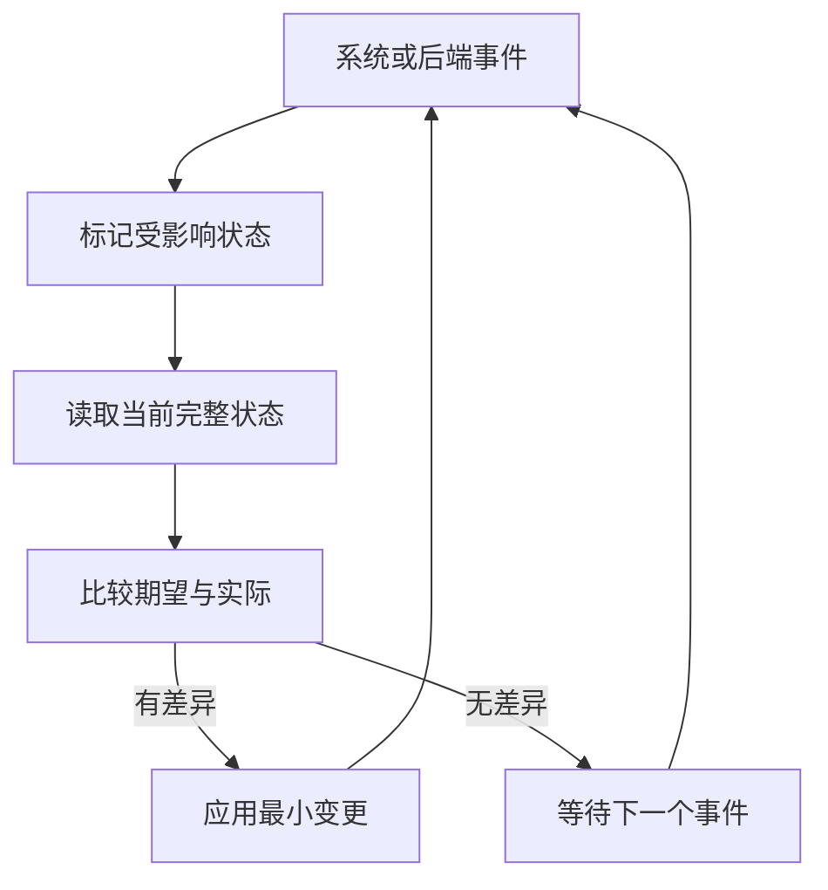

# Linux 透明代理与路由托管方案

**状态：设计方案，尚未实现。`mihomo-optimized-v1.0.5` 不识别下面的 `transparent-proxy` 配置，也不会恢复用户自行添加的路由。** 该文档用于评审 TCP / UDP 独立接管、IPv4 / IPv6 动态变化和重载后的自动恢复。

## YAML 入口

沿用已有 TUN 与 TProxy 监听设置，新增一个顶层入口统一拥有防火墙、策略规则和路由。下面对应 TCP 走 TProxy、UDP 走 TUN 的现有部署：

```yaml
ipv6: true
tproxy-port: 7895

tun:
  enable: true
  device: utun
  auto-detect-interface: true
  auto-route: false
  auto-redirect: false

transparent-proxy:
  enable: true
  tcp: tproxy # tproxy | tun | "off"
  udp: tun   # tproxy | tun | "off"

  routing:
    tproxy:
      mark: 0x1
      table: 100
      priority: 1000
    tun:
      mark: 0x162
      table: 101
      priority: 1010

  local:
    enable: true
    interfaces: [eth0]
    bypass-users: [mihomo]
    bypass-udp-ports: [123]

  gateway:
    enable: true
    interfaces: ["*"]

  bypass:
    reserved-addresses: true
    interface-prefixes: [eth0]
    extra-addresses: []
```

`mark`、`table`、`priority` 分别控制匹配的 fwmark、路由表编号和策略规则优先级，支持分别配置 TProxy 与 TUN。示例 mark 使用完整 32 位精确匹配，与原有 `ip rule add fwmark ... table ...` 一致；第一版不另加 mask 选项。更小的 `priority` 更先匹配，必须保留系统 local 规则和现有外部策略的语义。

| 后端 | 示例标记 / 表 | IPv4 路由 | IPv6 路由 |
| --- | --- | --- | --- |
| TProxy | `0x1` / `100` | `local 0.0.0.0/0 dev lo` | `local ::/0 dev lo` |
| TUN | `0x162` / `101` | `default dev <实际 TUN>` | `default dev <实际 TUN>` |

`lo` 与 TUN 设备绑定从后端推导，不开放任意路由命令或下一跳输入。TUN 路由使用当前网络命名空间中的真实 ifindex；同名设备删除后重建，必须重新解析并绑定。

标记应非零且互不相同，不能与内核出站防环标记冲突。路由表不能使用系统保留表，两个后端不能把不同默认路由写入同一张表。优先级、表和标记的冲突须在启用捕获前明确报告，不自动删除其他软件的规则，也不静默更改用户指定值。

两个协议独立选后端，共用某后端时只创建一份路由资源；无人使用的后端不创建资源。`"off"` 表示本模块不捕获该协议，包括该协议的 FakeIP 流量，不代表在 mihomo 规则中选择 DIRECT。TCP / UDP 的入口选择不改变后续业务规则的出站选择。

## 与原有 TUN 自动路由的关系

`tun.auto-route` 负责原有 TUN 自动路由，`tun.auto-redirect` 依赖它管理自己的转发规则；这两个入口不承担本方案的 TCP / UDP 分别接管。

本方案建议采用明确的优先级：启用 `transparent-proxy` 后，由该模块单独管理捕获路径。运行态配置把 `tun.auto-route`、`tun.auto-redirect` 和旧 `iptables.enable` 规范化为关闭，并在日志和生效配置中说明原因；不改写磁盘 YAML。规范化发生在监听器配置比较与应用之前，避免相同配置重载引起重复重建。关闭新模块后恢复原有字段的语义。这是新模块的拟定接管规则，当前版本仍按原有 TUN 配置运行。

TUN / TProxy 监听实现和现有拨号层继续复用。TCP、UDP 都选 TUN 时，管理的仍是这两个协议，不把它描述成与原版所有流量接管完全相同。

## 系统事件驱动

**不提供 `reconcile-interval`，正常运行不定期扫描网络状态。** 监听以下 Linux 事件：

| 事件 | 对应处理 |
| --- | --- |
| link 新增、删除、up / down | 重新核对受影响接口；TUN 重建时更新 ifindex 和自有路由 |
| IPv4 / IPv6 地址新增、删除、状态变化 | 更新受影响接口的有效地址与排除前缀 |
| IPv4 / IPv6 route 变化 | 更新默认出口判断和相关直连前缀，恢复缺失的自有路由 |
| IPv4 / IPv6 rule 变化 | 核对并恢复自有 fwmark 策略规则 |
| nftables table / chain / rule / set / element 事务 | 核对并恢复本模块的规则或集合 |
| 成功重载配置、后端启停 | 根据最新配置及监听器就绪状态重新计算期望状态 |

进程启动、配置重载、重新建立事件订阅后需要完整读取当前状态；这属于初始化或恢复。事件可在短时间内合并，但没有事件时不产生下一轮工作。错误后的退避重连、失败事务重试可以使用定时器，不把它们变成日常巡检周期。



接收循环只接收与排队，不执行耗时下载、重载或防火墙提交。单一应用队列串行收敛状态，所有入口共享同一份配置代次和对象所有权。

### 复用范围与需要补齐的底层能力

当前固定的 `sing-tun v0.4.27` 网络监视器只订阅 route / link，并通过无参数回调通知变化；它没有 address、rule、nftables 完整订阅，也没有完整的订阅故障恢复。其生命周期跟随 TUN listener，因此不能直接承担纯 TProxy 模式的独立管理。

复用已经依赖的 `sagernet/netlink`、`metacubex/nftables` 与 netlink transport，无需执行 `ip monitor` 或维护 shell 子进程。现有 link / route / address 订阅和 nftables monitor 可作为基础；补齐 rule 组订阅、消息完整性校验与重连语义。nftables 先接收包含 NEWGEN 的完整事务，在应用层筛选本模块对象，避免过滤器丢掉批次结束消息。

先建立订阅并开始接收，再读取快照，避免快照与订阅之间漏掉事件。快照期间有变化时，把相应状态标为需要重新读取；不把时间较早的缓存事件盲目覆盖到较新的快照上。通知 socket 与请求 socket 分开。

`ENOBUFS`、截断消息、`NLM_F_DUMP_INTR`、解析错误、意外关闭或队列溢出意味着观察状态可能不完整。此时停止基于该快照删除对象，废弃旧观察代次，重新订阅并完整同步；失败则退避重试。不能屏蔽 ENOBUFS，也不能把断开的 channel 当成持续的正常网络事件。

自己的写操作也会产生事件；通过规范化后的期望 / 实际比较结束反馈，不能用“写完忽略一秒事件”丢弃外部变化。计数器、时间戳和地址剩余寿命不作为必须重写的差异。

## IPv4 / IPv6 与前缀变化

动态前缀从指定接口的实际地址与掩码获得，不假定 IPv4 是 `/24`、IPv6 是 `/64`。同一前缀存在多个有效地址时合并贡献；最后一个有效地址消失后才删除前缀。读取成功但地址集合为空需要移除旧动态前缀；读取失败保留上一次完整状态并恢复观察，不能把失败当作确认删除。

忽略 tentative、DAD failed 和已经失效的地址；preferred lifetime 到期但 valid lifetime 尚未到期的地址仍保留。地址过期由内核 NEWADDR / DELADDR 事件触发，无需自行轮询倒计时。无限有效期按无符号值处理，避免 32 位平台溢出。

WAN 地址、隐私地址轮换、接口重连、默认路由变化按 IPv4 / IPv6 分别处理。使用 `auto` 出口时分别判断两个地址族，不能仅复用原监视器“main 表第一个默认路由”的结果。LAN 的委派前缀从实际 LAN 接口或相关直连路由学习，不从一个 WAN 地址猜测整个 PD 范围，也不把 `0/0` 或 TUN 派生路由当作排除网段。

全局 `ipv6: false` 明确停用本模块 IPv6 接管。配置允许 IPv6、但启动时暂时没有可用 IPv6 时，保留用户声明的期望状态；IPv6 条件就绪后再配置资源，不能永久清空原始配置。普通 WAN 地址或前缀变化只更新必要集合与路由，不重建 TUN。

`reserved-addresses` 的初始集合保持现有 nftables 部署的静态排除范围，不用 `IsPrivate` 代替全部语义：

| 地址族 | 初始静态排除网段 |
| --- | --- |
| IPv4 | `0.0.0.0/8`、`10.0.0.0/8`、`100.64.0.0/10`、`127.0.0.0/8`、`169.254.0.0/16`、`172.16.0.0/12`、`192.168.0.0/16`、`224.0.0.0/4`、`240.0.0.0/4` |
| IPv6 | `::/127`、`::ffff:0.0.0.0/96`、`::ffff:0:0:0/96`、`64:ff9b::/96`、`100::/64`、`2001::/32`、`2001:20::/28`、`2001:db8::/32`、`2002::/16`、`fc00::/7`、`fe80::/10`、`ff00::/8` |

系统判定为 local、broadcast、anycast 或 multicast 的目的地址也保留现有排除语义。动态公网前缀不写入这份静态列表，而由 `interface-prefixes` 学习。FakeIP 网段从已生效 DNS 配置读取，优先于这些排除网段。

## 防环与流量顺序

本机流量先排除内核自己的出站，再处理捕获；内核出站范围包含 DNS、代理连接、GeoData / rule-provider / UI / core 下载和其他后台连接。复用现有 socket mark 能力，保留用户明确配置的 `routing-mark` 和节点 mark；内部标记不能盲目按位 OR 到已有完整匹配标记上。`bypass-users: [mihomo]` 是额外排除，不能因进程以 root 运行而自动排除所有 root 流量。

处理顺序为：自身出站与 TUN 回流防环 → 已标记的 TProxy 本机回流 → 接管接口范围 → FakeIP → 本地 / 特殊 / 动态前缀排除 → 本机端口排除 → 其余选中流量。不能一概排除 `lo`，因为 TProxy 本机 OUTPUT 流量正是经 local 路由回到 PREROUTING；`bypass-udp-ports: [123]` 保持仅本机生效，且不抢在 FakeIP 之前。

网关模式核对必要的转发、rp_filter 和 IPv6 RA 接收设置。开启 IPv6 forwarding 时必须兼顾 WAN 的 RA 路由获取；保存本模块实际修改的原值，退出时仅在仍归本模块管理时恢复。沿用透明代理所需的网络管理能力，不增加启动后 shell 路由脚本。

## 启停、重载与外部修改

启动依次准备后端、路由与规则，确认可用后以 nftables 原子事务启用捕获。关闭按相反依赖顺序撤掉捕获再移除资源。TCP / UDP 的就绪分别判断，某个后端未准备好时不影响另一协议；受影响的接管流量暂时拒绝，已有排除流量继续通过，避免空策略表意外回落到 main 表直出。

相同有效 TUN 配置的重载继续复用原设备。需要重建设备时，由生命周期事件和 link 事件通知同一管理器恢复路由；不会依赖 systemd `ExecStartPost` 再次运行。内核自更新的 reexec 也从完整期望状态重新建立管理。

使用独立 nftables 表和明确的所有权记录，只替换或清理自有对象。管理员 `flush ruleset` 或删除自有路由会触发恢复，但外部删除到事件修复之间存在窗口，不能承诺全程零中断。后端切换或重建可能需要已有连接重新建立。

迁移时一次性移除旧的手写 nftables 接管表、systemd `ExecStartPost` / `ExecStop` 路由命令和每分钟更新 IPv6 前缀的 cron，保留其他防火墙规则。两个控制器不能同时管理相同资源。进程意外退出后的启动清理和接管必须验证 owner，不能仅凭 table 编号删除外部对象。

## 实现验收范围

在隔离 network namespace 中覆盖 TCP / UDP 后端组合、双栈本机与网关流量、FakeIP 优先级、防环、IPv4 / IPv6 地址增删与寿命变化、TUN ifindex 更换、route / rule / nft 对象被删、事件丢失重连、配置快速重载和进程重启。验证空闲时无周期扫描、自产事件能够收敛，且清理不影响外部表和规则。保持现有 DNS 分流、查询连接共享与 UI 设计。

## 依据

- [Mihomo TUN 配置](https://wiki.metacubex.one/config/inbound/tun/)
- [Linux TProxy 与 local 策略路由](https://www.kernel.org/doc/html/latest/networking/tproxy.html)
- [Linux Netlink：通知、消息截断与不完整 dump](https://www.kernel.org/doc/html/latest/userspace-api/netlink/intro.html)
- [Linux 网络 sysctl：IPv6 forwarding 与 accept_ra](https://www.kernel.org/doc/html/latest/networking/ip-sysctl.html)
- [sing-tun v0.4.27 网络监视器](https://github.com/MetaCubeX/sing-tun/blob/v0.4.27/monitor_linux.go)

