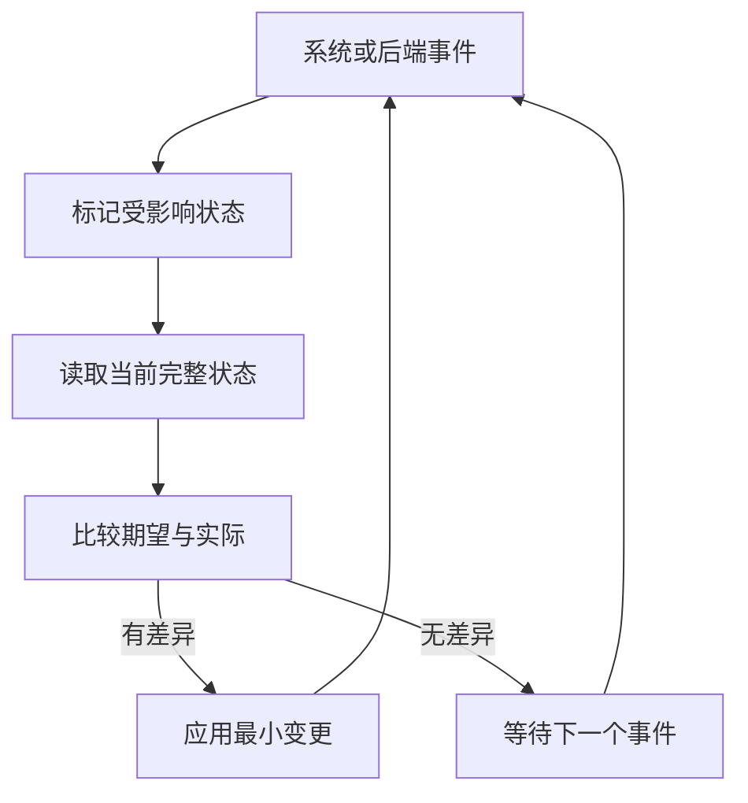

# Linux 透明代理与路由托管

从 **`mihomo-optimized-v1.0.6`** 起，Linux 可通过顶层 `transparent-proxy` 分别选择 TCP / UDP 入口，由内核管理对应 nftables 捕获、策略规则和路由，并通过系统事件恢复缺失的自有资源。默认关闭；旧版本不识别此配置。后端选择不改变 mihomo 的业务分流规则。

## YAML 入口

沿用已有 TUN 与 TProxy 监听设置，新增一个顶层入口统一拥有防火墙、策略规则和路由。下面对应 TCP 走 TProxy、UDP 走 TUN 的现有部署：

```yaml
ipv6: true
tproxy-port: 7895

tun:
  enable: true
  device: utun
  auto-detect-interface: true
  auto-route: false
  auto-redirect: false

transparent-proxy:
  enable: true
  tcp: tproxy # tproxy | tun | "off"
  udp: tun   # tproxy | tun | "off"

  routing:
    tproxy:
      mark: 0x1
      table: 100
      priority: 1000
    tun:
      mark: 0x162
      table: 101
      priority: 1010

  local:
    enable: true
    interfaces: [eth0]
    bypass-users: [mihomo]
    bypass-udp-ports: [123]

  gateway:
    enable: true
    interfaces: ["*"]

  bypass:
    reserved-addresses: true
    interface-prefixes: [eth0]
    extra-addresses: []
```

`mark`、`table`、`priority` 分别控制 fwmark、路由表编号和策略规则优先级。mark 使用完整 32 位精确匹配，内核显式写入 `0xffffffff` 掩码；没有额外 mask 字段。数字支持 YAML 整数和 `0x` 十六进制，不接受数字字符串、小数、负数或溢出值。

每个后端使用 **`priority` 的查表规则和 `priority + 1` 的终止黑洞规则**。后者防止查表规则或表内转发路由单独丢失时，已标记流量继续落到系统 `main` 表。`priority` 可取 `1..32764`，两组优先级不能重叠；保留系统优先级 `0` 的 local 查找，并在通常的 `32766` main 查找之前完成处理。更早的外部策略会改变这个保证，因此启用前会检查冲突。

| 后端 | 示例标记 / 表 | IPv4 路由 | IPv6 路由 |
| --- | --- | --- | --- |
| TProxy | `0x1` / `100` | `local 0.0.0.0/0 dev lo` | `local ::/0 dev lo` |
| TUN | `0x162` / `101` | `default dev <实际 TUN>` | `default dev <实际 TUN>` |

`lo` 与 TUN 设备绑定从后端推导。TUN 路由使用监听器创建时记录的真实 ifindex，不能把外部新建的同名设备当成原监听器。表内正常路由的 metric 为 `100`，另有 metric 为 `1073741824` 的常驻 blackhole 默认路由；该黑洞不依赖 TUN 设备。IPv4 与 IPv6 各自管理相同编号的表和规则。

标记应非零且互不相同，不能与内核出站防环标记冲突。路由表不能使用系统保留表，两个后端不能把不同默认路由写入同一张表。优先级、表和标记的冲突须在启用捕获前明确报告，不自动删除其他软件的规则，也不静默更改用户指定值。

两个协议独立选后端，共用某后端时只创建一份路由资源；无人使用的后端不创建资源。`"off"` 表示本模块不捕获该协议，包括该协议的 FakeIP 流量，不代表在 mihomo 规则中选择 DIRECT。TCP / UDP 的入口选择不改变后续业务规则的出站选择。

### 默认值与必要条件

| 配置 | 默认值 / 约束 |
| --- | --- |
| `enable` | `false`；仅 Linux 可启用 |
| `tcp` / `udp` | `tproxy` / `tun`，分别支持 `tproxy`、`tun`、`"off"` |
| `routing.tproxy` | mark `0x1`、table `100`、priority `1000`（同时占用 `1001`） |
| `routing.tun` | mark `0x162`、table `101`、priority `1010`（同时占用 `1011`） |
| `local.enable` / `local.interfaces` | `true` / `[auto]`；`auto` 按地址族选择当前出口，`["*"]` 表示全部接口，空列表不接管本机流量 |
| `local.bypass-users` | `[]`；接受用户名或十进制 UID，不默认排除 root |
| `local.bypass-udp-ports` | `[123]`；只影响本机普通 UDP，FakeIP 优先 |
| `gateway.enable` / `gateway.interfaces` | `false` / `["*"]`；只在显式开启后接管网关入站 |
| `bypass.reserved-addresses` | `true`，静态范围见下表 |
| `bypass.interface-prefixes` | `[auto]`；也可指定真实 LAN/WAN 接口列表，`["*"]` 学习所有适用接口 |
| `bypass.extra-addresses` | `[]`；IPv4 / IPv6 CIDR，不接受默认路由前缀 |

选择 TUN 时要求 `tun.enable: true`，选择 TProxy 时要求有效 `tproxy-port`。托管 TProxy 使用通配地址监听原始目的地址，不受 HTTP / SOCKS 的 `allow-lan` 绑定限制。需要 Linux 的网络管理权限及 nftables TProxy/socket 内核支持；运行用户仍可使用 `mihomo`。不需要安装命令行 `nft` 或 `ip` 来执行后台维护。

不创建 `transparent-proxy/` 子目录或 `state.json`，不需要为本模块给 `-d` 数据目录增加写权限；配置文件可以继续由 root 持有并保持只读。也不增加保存恢复日志的 nftables 集合、映射、额外表或跨进程内存文件。实际工作的 nftables 对象带固定模块注释，路由与策略规则带专用协议标识；这些都是工作资源自身的属性，没有另存配置副本或操作历史。

未知字段会报错，包括已经决定不提供的 `reconcile-interval`。这些配置通过完整 YAML 重载应用；控制器的局部 PATCH 不用于改变整套透明代理策略。

### 官方写法核对与选择依据

Linux [TProxy 官方文档](https://docs.kernel.org/networking/tproxy.html) 的示例就是 `fwmark 1 lookup 100` 与 `local 0.0.0.0/0 dev lo table 100`。因此保留 TProxy 的 local 路由；TUN 使用独立表中的设备默认路由。表号用于标识，并不存在 `100` 比 `2022` 更慢的机制。[iproute2 手册](https://github.com/iproute2/iproute2/blob/main/man/man8/ip-route.8.in) 保留 `0`、`253`、`254`、`255`，允许其他 32 位表号；不需要往系统 `rt_tables` 写名字才能使用数字表号。

[ip-rule 手册](https://github.com/iproute2/iproute2/blob/main/man/man8/ip-rule.8.in) 建议显式设置唯一优先级。这里使用可配置优先级及后一位黑洞保护，不依赖 `ip rule add` 自动分配顺序。完整 mark 匹配避免把 `0x163` 等无关标记误认为 `0x1`；如果另一软件也占用这些完整值，需要调整配置，不能用按位 OR 改写其含义。

[Netfilter 手册](https://netfilter.org/projects/nftables/manpage.html) 定义 `mangle` 为 `-150`、普通 `filter` 为 `0`。捕获链采用 `mangle`，位于连接跟踪之后、常规 DNAT 之前；本机使用 `type route hook output`，确保修改 mark 后触发重新选路。已有防火墙的后续 drop 仍生效，独立捕获表不会绕过它。

Mihomo 原生 `auto-route` 的默认表号是 `2022`、规则起点为 `9000`；它们是原自动路由模块的默认编号，不是 Linux 的保留编号或本模块必须采用的值。本模块保持上述明确、可配置的两组编号，避免混用两套资源所有者。黑洞使用真正终止查找的 `blackhole`，不使用允许继续查后续策略的 `throw`。

## 与原有 TUN 自动路由的关系

`tun.auto-route` 负责原有 TUN 自动路由，`tun.auto-redirect` 依赖它管理自己的转发规则；这两个入口不承担本方案的 TCP / UDP 分别接管。

启用 `transparent-proxy` 后，由该模块单独管理捕获路径。运行态把 `tun.auto-route`、`tun.auto-redirect` 和旧 `iptables.enable` 规范化为关闭，日志和 `GET /configs` 显示生效值；不改写磁盘 YAML。规范化发生在监听器配置比较与应用之前，避免相同配置重载引起重复重建。关闭新模块后恢复原有字段语义。

TUN / TProxy 监听实现和现有拨号层继续复用。TCP、UDP 都选 TUN 时，管理的仍是这两个协议，不把它描述成与原版所有流量接管完全相同。

## 系统事件驱动

**不提供 `reconcile-interval`，正常运行不定期扫描网络状态。** 监听以下 Linux 事件：

| 事件 | 对应处理 |
| --- | --- |
| link 新增、删除、up / down | 重新核对受影响接口；TUN 重建时更新 ifindex 和自有路由 |
| IPv4 / IPv6 地址新增、删除、状态变化 | 更新受影响接口的有效地址与排除前缀 |
| IPv4 / IPv6 route 变化 | 更新默认出口判断和相关直连前缀，恢复缺失的自有路由 |
| IPv4 / IPv6 rule 变化 | 核对并恢复自有 fwmark 查表规则与终止黑洞规则 |
| IPv4 / IPv6 NETCONF 变化 | 重新核对转发等网络条件 |
| nftables table / chain / rule / set / element 事务 | 核对并恢复本模块的规则或集合 |
| 成功重载配置、后端启停 | 根据最新配置及监听器就绪状态重新计算期望状态 |

进程启动、配置重载、重新建立事件订阅后需要完整读取当前状态；这属于初始化或恢复。事件可在短时间内合并，但没有事件时不产生下一轮工作。错误后的退避重连、失败事务重试可以使用定时器，不把它们变成日常巡检周期。



接收循环只接收与排队，不执行耗时下载、重载或防火墙提交。单一应用队列串行收敛状态，所有入口共享同一份配置代次和对象所有权。

### 复用范围与需要补齐的底层能力

当前固定的 `sing-tun v0.4.27` 网络监视器只订阅 route / link，并通过无参数回调通知变化；它没有 address、rule、nftables 完整订阅，也没有完整的订阅故障恢复。其生命周期跟随 TUN listener，因此不能直接承担纯 TProxy 模式的独立管理。

复用已有依赖 `mdlayher/socket` 的上下文感知 socket，以及 nftables 表达式编码；在模块内部处理完整 netlink 消息。请求与事件不依赖 TUN listener 的存活，也不执行 `ip monitor` 或 shell 子进程。订阅 route/link/address/rule/NETCONF 和 nftables NEWGEN，按完整状态计算差异。

先建立订阅并开始接收，再读取快照，避免快照与订阅之间漏掉事件。快照期间有变化时，把相应状态标为需要重新读取；不把时间较早的缓存事件盲目覆盖到较新的快照上。通知 socket 与请求 socket 分开。

`ENOBUFS`、截断消息、`NLM_F_DUMP_INTR`、解析错误、意外关闭或队列溢出意味着观察状态可能不完整。此时停止基于该快照删除对象，废弃旧观察代次，重新订阅并完整同步；失败则退避重试。不能屏蔽 ENOBUFS，也不能把断开的 channel 当成持续的正常网络事件。

自己的写操作也会产生事件；通过规范化后的期望 / 实际比较结束反馈，不能用“写完忽略一秒事件”丢弃外部变化。计数器、时间戳和地址剩余寿命不作为必须重写的差异。

## IPv4 / IPv6 与前缀变化

动态前缀从指定接口的实际地址与掩码获得，不假定 IPv4 是 `/24`、IPv6 是 `/64`。同一前缀存在多个有效地址时合并贡献；最后一个有效地址消失后才删除前缀。读取成功但地址集合为空需要移除旧动态前缀；读取失败保留上一次完整状态并恢复观察，不能把失败当作确认删除。

忽略 tentative、DAD failed 和已经失效的地址；preferred lifetime 到期但 valid lifetime 尚未到期的地址仍保留。地址过期由内核 NEWADDR / DELADDR 事件触发，无需自行轮询倒计时。无限有效期按无符号值处理，避免 32 位平台溢出。

WAN 地址、隐私地址轮换、接口重连、默认路由变化按 IPv4 / IPv6 分别处理。使用 `auto` 出口时分别进行内核路由查询。LAN 的委派前缀从 `interface-prefixes` 指定的实际 LAN 接口地址学习，不从一个 WAN 地址猜测整个 PD 范围，也不把 `0/0` 或 TUN 派生路由当作排除网段。多出口且有复杂策略时可显式填写接口。

全局 `ipv6: false` 停用本模块 IPv6 接管。配置允许 IPv6、但启动时系统 IPv6 栈不可用时，保留用户声明的期望状态，已有 IPv4 后端继续工作；系统恢复后重试缺少的 IPv6 后端。判定依据包括实际监听 socket 和 TUN 地址，不把“配置允许 IPv6”当作已经就绪，也不会开启管理员禁用的 IPv6 栈。普通 WAN 地址或前缀变化只更新必要集合与路由，不重建 TUN。

如果系统处于 IPv6 禁用状态，而 YAML 仍要求 IPv6 TUN，主动关闭前仍须验证该地址族的保护。系统无法安装或读回所需保护时，需要重建 TUN 的重载和受控重启会失败并保留原进程；首次启动没有旧 TUN 可关闭，仍可先运行 IPv4。系统恢复 IPv6 后会补齐保护。如果确实停用 IPv6，应同步设置 YAML 的 `ipv6: false`。

`reserved-addresses` 的初始集合保持现有 nftables 部署的静态排除范围，不用 `IsPrivate` 代替全部语义：

| 地址族 | 初始静态排除网段 |
| --- | --- |
| IPv4 | `0.0.0.0/8`、`10.0.0.0/8`、`100.64.0.0/10`、`127.0.0.0/8`、`169.254.0.0/16`、`172.16.0.0/12`、`192.168.0.0/16`、`224.0.0.0/4`、`240.0.0.0/4` |
| IPv6 | `::/127`、`::ffff:0.0.0.0/96`、`::ffff:0:0:0/96`、`64:ff9b::/96`、`100::/64`、`2001::/32`、`2001:20::/28`、`2001:db8::/32`、`2002::/16`、`fc00::/7`、`fe80::/10`、`ff00::/8` |

系统判定为 local、broadcast、anycast 或 multicast 的目的地址也保留现有排除语义。动态公网前缀不写入这份静态列表，而由 `interface-prefixes` 学习。FakeIP 网段从已生效 DNS 配置读取，优先于这些排除网段。

## 防环与流量顺序

本机流量先排除内核自己的出站，再处理捕获；范围包含 DNS、代理连接、GeoData / rule-provider / UI / core 下载和其他后台连接。在真实 socket 的 Control 阶段注册并设置 SO_MARK，用户明确配置的节点 mark / `routing-mark` 保留完整值，没有指定时使用内部 `0x4d484d4f`。新显式 mark 的排除规则提交成功后才允许 socket 发送。

启用和完成重载时还会检查本进程已经打开的 IPv4 / IPv6 socket；修改前固定描述符身份，失败可回退原 mark，避免正在复用的 DNS/HTTP 连接被重新捕获。入站服务回复通过 OUTPUT 的连接跟踪 reply 方向排除。`bypass-users: [mihomo]` 是额外排除，不会因为内核以 root 运行就放过所有 root 应用流量。

处理顺序为：自身出站与 TUN 回流防环 → 已标记的 TProxy 本机回流 → 接管接口范围 → FakeIP → 本地 / 特殊 / 动态前缀排除 → 本机端口排除 → 其余选中流量。不能一概排除 `lo`，因为 TProxy 本机 OUTPUT 流量正是经 local 路由回到 PREROUTING；`bypass-udp-ports: [123]` 保持仅本机生效，且不抢在 FakeIP 之前。

网关模式配置所需转发、rp_filter 和 IPv6 RA 接收。IPv4 对需要转发的接口设置 forwarding，避免全局 `ip_forward` 切换的额外重置；IPv6 所需的全局 forwarding 改动及默认/接口副作用，在写入前把原值保存在本进程内存中。原本接受 RA 的出口在转发期间使用 `accept_ra=2`，明确配置为 `0` 的接口保持不接受。退出只在当前值仍等于本模块写入值、接口身份也匹配时恢复原值。

## 启停、重载与外部修改

启动先准备黑洞、策略规则与网络条件，再以 nftables 原子事务启用捕获；实际就绪的后端才安装转发路由。关闭先撤掉捕获，再移除自有路由和恢复设置。TCP / UDP 及 IPv4 / IPv6 的就绪分别判断；某个后端未准备好时，受影响的接管流量暂时丢弃，其他就绪协议与明确排除的流量继续通过。

相同有效 TUN 配置的重载继续复用原设备。需要重建时，顺序固定为：

1. **同步确认已启用地址族的黑洞默认路由、查表规则和终止黑洞规则；撤去指向旧 TUN 的转发路由，并读回验证。** 开启 IPv6 时同时验证双栈。
2. 将受影响的捕获流量设为不可用状态，然后关闭旧 TUN。第 1 步失败时保留旧设备并返回明确错误。
3. 建立新监听器，确认实际设备身份与地址，恢复对应转发路由，最后恢复捕获。

完整 YAML 重载、控制器局部 TUN 修改、后台缺失后端修复都经过同一关闭入口。常驻黑洞也覆盖设备意外消失；不会依赖 systemd `ExecStartPost` 再次运行。重建失败期间保持保护并按故障退避重试。

控制器重启与内核自更新的 reexec 会先同步确认路由保护，再把所有接管后端切到丢弃状态。关闭监听器成功前，观察器继续运行但不会恢复转发；清理失败则发布实际剩余后端并恢复管理，之后再次重启仍须重新验证保护。监听器清理成功后，在仍被阻断的状态下恢复本进程修改的系统参数，再释放观察连接与管理锁。只保留实际 nft 捕获/阻断规则及黑洞路由跨越进程替换，新进程从当前 YAML 和实际工作资源接回。系统参数恢复失败也会中止交接，不提前取消仍可恢复的配置后台任务。保护准备失败时不关闭旧后端，也不报告已进入重启。内核二进制若已完成替换，会在 API 结果和内核日志中明确说明文件已安装、当前旧进程尚未重启；面板 0.4.7 对此显示通用失败提示，可查看内核日志。

### 启动恢复与资源范围

工作资源位于当前 Linux 网络命名空间：nftables 使用独立表 `mihomo_optimized_tp` 及固定模块注释，策略规则与路由使用专用 `protocol 197`。通过完整 mark、表号、优先级、路由类型、metric、设备身份和保护组结构核对，不仅凭某个编号删除对象。此完整资源约定应保留给本模块；若管理员主动创建所有标识和结构均完全相同的对象，内核没有额外来源信息可供区分。

同配置启动可按当前 YAML 接回结构匹配的资源并补齐缺项。配置变化时，还会从本模块实际捕获规则中的 mark 与地址族，关联规范的查表规则、相邻黑洞规则和表内黑洞，识别可确认的旧资源并逐步撤销。未能关联的历史碎片不被猜测认领；只在它们与当前资源发生实际冲突时报告问题，不因无关残留拒绝当前配置。同一命名空间通过抽象 Unix socket 保证只有一个托管实例，不产生锁文件。

修改前的 sysctl 值、当次已建立和待清理资源只保存在进程内存。正常停止及受控重启时，仍按当前值是否等于本模块写入值、接口身份是否匹配来恢复本次基线。崩溃或 SIGKILL 会丢失此前的内存原值；新进程以当前系统参数为基线，不虚构上个进程的旧值。系统重启后网络资源按内核正常生命周期消失，不需要清理旧磁盘记录。

### 正常停止与 systemd

`systemctl stop mihomo` 使用服务正常的 SIGTERM 退出路径：先同步撤掉本模块捕获，再清理自有策略规则、活动/黑洞路由与系统参数，最后关闭 TUN 和其他后台服务。nftables 自有规则、集合、链及空表都会删除，不为下一次启动保留 owner 集合或空容器。管理员在专用表中另加的外部对象不被删除；外部引用需要的容器会保留并明确告知。

撤销捕获失败时继续保留路由保护；捕获撤销成功后停止重新布置。剩余清理失败时保留本次内存状态与管理锁，并退避重试，不会丢弃错误后报告成功退出。启动早期即接收停止信号，避免配置初始化期间收到 SIGTERM 就绕过正常清理。强制 SIGKILL、系统崩溃或 systemd 停止超时后的强制终止无法执行程序清理代码，不能承诺这类强制退出与正常 stop 相同。不要保留旧的 `ExecStop` 手工删路由命令，以免它抢在内核自身退出顺序之前破坏保护。

管理员 `flush ruleset` 或删除自有路由会触发恢复。只删除 TUN 设备或单条查表规则时，常驻保护继续生效；如果管理员同时删除捕获和全部保护，事件恢复前仍存在窗口，不能承诺任意外部清空操作都零泄漏。后端切换或重建可能需要已有连接重新建立。

迁移时一次性移除旧的手写 nftables 接管表、systemd `ExecStartPost` / `ExecStop` 路由命令和每分钟更新 IPv6 前缀的 cron，保留其他防火墙规则。两个控制器不能同时管理相同资源。进程意外退出后的接回依据实际工作对象及完整结构，不能仅凭 table 编号删除外部对象。

## 验证范围

Go 行为回归检查配置语义、协议/地址族就绪、前缀增删、TUN 身份、同步关闭屏障、错误传播、观察丢失重订阅和清理重试。Linux CI 另设必须通过的隔离 network namespace 检查：真实安装/读回 nftables、删除对象恢复、外部对象保留，以及 TUN 黑洞期间的实际 IPv4 / IPv6 已标记报文。实际内核进程还须通过直接 SIGTERM、控制器重启后的 SIGTERM，以及 systemd 临时单元的 `systemctl stop` 回归；退出后核对没有自有 nftables/策略规则/路由残留、外部哨兵仍在、本次系统参数已恢复且没有新增状态目录。无特权环境只运行普通回归，不把跳过内核测试算成完成验证。

## 依据

- [Mihomo TUN 配置](https://wiki.metacubex.one/config/inbound/tun/)
- [Linux TProxy 与 local 策略路由](https://www.kernel.org/doc/html/latest/networking/tproxy.html)
- [iproute2 路由表、路由类型与 metric](https://github.com/iproute2/iproute2/blob/main/man/man8/ip-route.8.in)
- [iproute2 策略规则、优先级与 fwmark](https://github.com/iproute2/iproute2/blob/main/man/man8/ip-rule.8.in)
- [Netfilter 链类型、优先级与 nftables 事务](https://netfilter.org/projects/nftables/manpage.html)
- [Linux Netlink：通知、消息截断与不完整 dump](https://www.kernel.org/doc/html/latest/userspace-api/netlink/intro.html)
- [Linux 网络 sysctl：IPv6 forwarding 与 accept_ra](https://www.kernel.org/doc/html/latest/networking/ip-sysctl.html)
- [sing-tun v0.4.27 网络监视器](https://github.com/MetaCubeX/sing-tun/blob/v0.4.27/monitor_linux.go)
- [systemd 停止信号与强制终止](https://github.com/systemd/systemd/blob/main/man/systemd.kill.xml)

